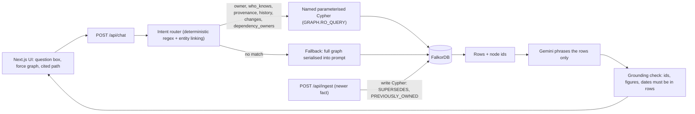
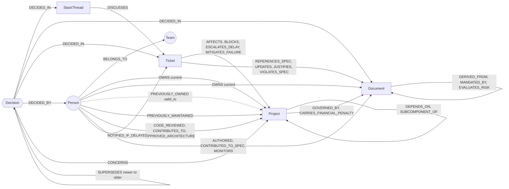

# Vanguard Aero Engine: a company brain that updates itself when facts change

> Ask who owns something, who knows about it, why a decision was made, and what changed. Every answer is a **FalkorDB Cypher traversal** with sources. When a newer fact arrives (a decision is overridden, an owner changes), the graph marks the old fact **superseded**, keeps it for history, and the *same question gets a different, cited answer*.

**Track entered:** Company Brain `[CONFIRM: exact track name as it appears on the submission form; one track per submission]`
**Team:** `[NAME 1]`, `[NAME 2]` · **Demo video:** `[VIDEO_URL]` · **Repo:** `[REPO_URL]`

---

## The problem

In a hardware company, the answer to "who do I ask about the ESC relay, and why is the thermal limit 180°C?" is spread across a spec, a Jira ticket, a Slack thread and somebody's head. Worse, it goes stale: the limit changes, the owner moves on, and the wiki still says the old thing. Search finds documents; it doesn't tell you which fact is *current* or where it came from.

## What it does (all of this is in the code)

| Focus area | How it is done |
|---|---|
| Docs, tickets, chats in one graph | Documents, Jira tickets and Slack threads are nodes in one FalkorDB graph, linked to people, teams, projects and decisions. |
| Who owns what | `Q1`: `(Person)-[:OWNS]->(Project\|Document)` plus team and previous owner. |
| Who knows what | `Q2`: direct edges (authored, reviewed, contributed, previously maintained…) and 2-hop evidence via neighbouring projects/docs/tickets, each row says *why* (`via`). |
| Tracing decisions to source | `Q3`: variable-length path from a `Decision` through `DECIDED_IN → DISCUSSES → UPDATES → DERIVED_FROM` to the originating thread, ticket and regulation. |
| Keeping knowledge current | `Q4`/`Q5` + `POST /api/ingest`: old decisions get `status='superseded'` and `valid_to`, a `SUPERSEDES` edge links new → old; replaced owners become `PREVIOUSLY_OWNED`. Nothing is deleted. |
| Answers with clear sources | The answer cites node ids/keys; the UI draws the evidence subgraph and shows the exact Cypher + parameters that produced it; a programmatic fact-check rejects any id, figure or date that is not in the returned rows. |
| Getting work done | From a traversed path, the UI drafts a Slack message to the people on it ("Notify"), and posts it through an incoming webhook if `SLACK_WEBHOOK_URL` is set (otherwise copies it). |

### 60-second demo (this is what the video shows)

1. Ask **"Who owns the ESC Power Relay Unit?"** → Sushma Patel, with team, sourced from the `OWNS` edge.
2. Ask **"Why was the ESC relay thermal limit lowered to 180°C?"** → the provenance chain: decision → `#compliance-faa` thread → AER-406 → Thermal Threshold Matrix → FAA Rule 107-B directive.
3. Run `npm run demo:change`. This overrides the 180°C decision (new decision sourced from ticket AER-408) and moves ownership of the relay unit to Tomás Herrera.
4. Ask **the same three questions again** → new owner *and* the former owner with the date, the 190°C decision as current with the 180°C and 200°C decisions shown as superseded, and a new provenance chain. Ask **"What changed since last week?"** → both events listed.

## Architecture



**Retrieval modes** (the API returns which one answered in the `retrieval` field):

| `retrieval` | When | What happens |
|---|---|---|
| `cypher:<intent>` | The question matches one of six intents *and* names an entity of the right type | A fixed, parameterised Cypher query runs via `GRAPH.RO_QUERY`; the LLM only phrases the returned rows. **This is the main path.** |
| `full-graph` | Anything else (e.g. "downstream impact of …", "which P1 tickets are open?") | The whole graph (~28k chars) is read from FalkorDB and serialised into the prompt. This is a fallback, not graph reasoning. |
| `cypher` (Text-to-Cypher) | Only if the serialised graph exceeds `MAX_FULL_GRAPH_CHARS` (60,000) | The model writes read-only Cypher, guarded by `lib/cypher-guard.ts`. `[CONFIRM: not exercised at current data size]` |

## Setup

Requirements: Docker, Node.js 20.9+ (tested on Node 22), a Gemini API key.

```bash
git clone [REPO_URL] && cd vanguard-aero-engine
cp .env.example .env.local      # set GEMINI_API_KEY; add DEMO_INGEST=1 to enable the demo update endpoint
npm ci
npm run setup                   # starts FalkorDB in Docker (6379; browser UI on 8001) and seeds the graph
npm run dev                     # http://localhost:3000
```

Optional:

```bash
npm run check:routes            # no-LLM check: each question routes to the intended Cypher query and returns rows
npm run demo:change             # apply the two demo "newer facts" to the running app (needs DEMO_INGEST=1)
npm run seed                    # reset the graph to baseline (the app caches the graph for SNAPSHOT_TTL_MS, default 30000)
```

Already running FalkorDB (or using FalkorDB Cloud)? Set `FALKORDB_URL` (default `redis://localhost:6379`) and run `npm run seed`.

## Graph data model



| Label | Key properties |
|---|---|
| `Team` | `id, name, focus` |
| `Person` | `id, name, role, team_id, email` |
| `Project` | `id, name, type, status` |
| `Document` | `id, title, name, type, author_id` |
| `Ticket` | `id, key, summary, severity, status, name` |
| `SlackThread` | `id, channel, topic, timestamp, name` |
| `Decision` | `id, name, statement, status ('active'\|'superseded'), valid_from, valid_to` |

**Size:** 102 nodes, 170 relationships (100 nodes / 163 edges base seed + 2 decisions / 7 edges). Seed data is in `data/seed_data.json` and `data/decisions.json`.

**How "current vs superseded" is modelled**

- Decisions: `status` + `valid_from`/`valid_to`; `(new)-[:SUPERSEDES]->(old)`. The old decision stays queryable.
- Ownership: `OWNS` always means *current* owner. When it changes, the old edge is replaced by `(old)-[:PREVIOUSLY_OWNED {valid_from, valid_to, superseded_by}]->(x)`.
- Provenance: `(Decision)-[:DECIDED_IN]->(SlackThread|Document|Ticket)`, then the existing `DISCUSSES`, `UPDATES`, `DERIVED_FROM`, `MANDATED_BY` edges continue the chain to the root document.

## The Cypher the product depends on

These blocks are generated from `lib/queries.ts`, the code that actually runs.

#### Q1 · Who owns X?
_Parameters: `$id` = a Project or Document id_

```cypher
MATCH (p:Person)-[o:OWNS]->(x {id: $id})
OPTIONAL MATCH (p)-[:BELONGS_TO]->(t:Team)
OPTIONAL MATCH (prev:Person)-[h:PREVIOUSLY_OWNED]->(x)
RETURN x.id AS subject_id, x.name AS subject, p.id AS owner_id, p.name AS owner, p.role AS role,
       t.name AS team, o.valid_from AS owner_since,
       prev.id AS prev_owner_id, prev.name AS prev_owner, h.valid_to AS prev_owner_until
```

#### Q2 · Who knows about Y?
_Parameters: `$id` = a Project, Document or Ticket id_

```cypher
MATCH (p:Person)-[r]->(y {id: $id})
WHERE type(r) IN ['OWNS','AUTHORED','CONTRIBUTED_TO_SPEC','CODE_REVIEWED','APPROVED_ARCHITECTURE','OVERSEES_ARCHITECTURE','CONTRIBUTES_TO','MONITORS','NOTIFIED_IF_DELAYED','PREVIOUSLY_MAINTAINED','PREVIOUSLY_OWNED']
RETURN p.id AS person_id, p.name AS person, p.role AS role, type(r) AS via, 1 AS hops, y.id AS about_id, y.name AS about, '' AS through
UNION
MATCH (p:Person)-[r1]->(m)-[r2]-(y {id: $id})
WHERE (m:Project OR m:Document OR m:Ticket) AND p.id <> y.id AND m.id <> y.id
  AND type(r1) IN ['OWNS','AUTHORED','CONTRIBUTED_TO_SPEC','CODE_REVIEWED','MONITORS']
  AND type(r2) IN ['AFFECTS','DISCUSSES','DEPENDS_ON','REFERENCES_SPEC','UPDATES','DERIVED_FROM','MANDATED_BY','GOVERNED_BY','JUSTIFIES','CONCERNS','DECIDED_IN']
RETURN p.id AS person_id, p.name AS person, p.role AS role, type(r1) + ' -> ' + type(r2) AS via, 2 AS hops, y.id AS about_id, y.name AS about, m.name AS through
```

#### Q3 · Why was decision Z made, and where does it come from?
_Parameters: `$id` = a Decision id_

```cypher
MATCH path = (d:Decision {id: $id})-[:DECIDED_IN|DERIVED_FROM|DISCUSSES|UPDATES|MANDATED_BY|JUSTIFIES|REFERENCES_SPEC*1..4]->(src)
WHERE NOT (src)-[:DERIVED_FROM|DISCUSSES|UPDATES|MANDATED_BY|JUSTIFIES|REFERENCES_SPEC]->()
OPTIONAL MATCH (d)-[:DECIDED_BY]->(who:Person)
RETURN d.id AS decision_id, d.statement AS statement, d.status AS status, d.valid_from AS decided_at,
       who.name AS decided_by, [n IN nodes(path) | n.id] AS chain_ids, [n IN nodes(path) | n.name] AS chain_names,
       [r IN relationships(path) | type(r)] AS chain_rels, length(path) AS hops
ORDER BY hops DESC
```

#### Q4 · Supersession: what is current, what replaced what?
_Parameters: `$id` = a Project or Document id_

```cypher
MATCH (d:Decision)-[:CONCERNS]->(x {id: $id})
OPTIONAL MATCH (d)-[:SUPERSEDES]->(older:Decision)
OPTIONAL MATCH (newer:Decision)-[:SUPERSEDES]->(d)
RETURN x.name AS subject, d.id AS decision_id, d.statement AS statement, d.status AS status,
       d.valid_from AS valid_from, d.valid_to AS valid_to,
       older.id AS supersedes_id, newer.id AS superseded_by_id
ORDER BY d.valid_from DESC
```

#### Q5 · What changed since last week?
_Parameters: `$since` = ISO timestamp (now − 7 days by default)_

```cypher
MATCH (d:Decision) WHERE d.valid_from >= $since
RETURN 'decision_made' AS change, d.id AS id, d.statement AS what, d.valid_from AS at
UNION
MATCH (d:Decision) WHERE d.status = 'superseded' AND d.valid_to >= $since
RETURN 'decision_superseded' AS change, d.id AS id, d.statement AS what, d.valid_to AS at
UNION
MATCH (p:Person)-[o:OWNS]->(x) WHERE o.valid_from >= $since
RETURN 'owner_assigned' AS change, x.id AS id, p.name + ' now owns ' + x.name AS what, o.valid_from AS at
UNION
MATCH (p:Person)-[h:PREVIOUSLY_OWNED]->(x) WHERE h.valid_to >= $since
RETURN 'owner_ended' AS change, x.id AS id, p.name + ' no longer owns ' + x.name AS what, h.valid_to AS at
UNION
MATCH (s:SlackThread) WHERE s.timestamp >= $since
RETURN 'slack_thread' AS change, s.id AS id, s.name AS what, s.timestamp AS at
```

#### Q6 · Who owns what this project depends on?
_Parameters: `$id` = a Project id_

```cypher
MATCH path = (start:Project {id: $id})-[:DEPENDS_ON*1..4]->(dep:Project)
MATCH (p:Person)-[:OWNS]->(dep)
RETURN dep.id AS dep_id, dep.name AS dependency, min(length(path)) AS depth, p.id AS owner_id, p.name AS owner
ORDER BY depth
```

#### Helper · resolve "why is *this project* like this?" to its active decision (used before Q3)

```cypher
MATCH (d:Decision {status: 'active'})-[:CONCERNS]->(x {id: $id}) RETURN d.id AS id LIMIT 1
```

#### Write 1 · A decision is overridden (marks the old one superseded, keeps it)
_Parameters: `$oldId $newId $name $statement $sourceId $byId $at`_

```cypher
MATCH (old:Decision {id: $oldId}) WHERE old.status = 'active'
MATCH (src {id: $sourceId})
MATCH (who:Person {id: $byId})
SET old.status = 'superseded', old.valid_to = $at
CREATE (new:Decision {id: $newId, name: $name, statement: $statement, status: 'active', valid_from: $at})
CREATE (new)-[:SUPERSEDES]->(old)
CREATE (new)-[:DECIDED_IN]->(src)
CREATE (new)-[:DECIDED_BY]->(who)
WITH new, old
MATCH (old)-[:CONCERNS]->(x)
CREATE (new)-[:CONCERNS]->(x)
RETURN new.id AS new_id, old.id AS old_id, x.id AS concerns
```

#### Write 2 · An owner changes (old OWNS edge becomes PREVIOUSLY_OWNED, nothing is deleted from history)
_Parameters: `$id $newOwnerId $at`_

```cypher
MATCH (old:Person)-[o:OWNS]->(x {id: $id})
MATCH (np:Person {id: $newOwnerId}) WHERE old.id <> np.id
WITH old, o, x, np, o.valid_from AS since
DELETE o
CREATE (old)-[:PREVIOUSLY_OWNED {valid_from: since, valid_to: $at, superseded_by: np.id}]->(x)
CREATE (np)-[:OWNS {valid_from: $at}]->(x)
RETURN old.id AS old_owner, np.id AS new_owner, x.id AS subject
```

## What breaks if FalkorDB is removed

Everything in the main path. Ownership with team and history (Q1), 1- and 2-hop knowledge evidence merged with `UNION` (Q2), variable-length provenance chains with a leaf filter (Q3), supersession history (Q4), a five-way temporal `UNION` (Q5), and dependency traversal with shortest-depth aggregation (Q6) are all Cypher over FalkorDB. So are the two atomic write queries that supersede a decision or move an owner, and the read-only guarantee (`GRAPH.RO_QUERY`). There is no second datastore: the JSON seed is only loaded into FalkorDB, never read by the app at runtime.

What would *survive*: the `full-graph` fallback could be fed from the JSON file instead, and the UI would still render. That path is deliberately not the product. At 100 nodes a plain in-memory join would also answer Q1 and Q6; the graph earns its place on variable-depth chains (dependencies, provenance), on schema that grows without migrations (we added `Decision` and five relationship types without touching existing queries), and on returning *paths* as evidence, not just rows.

## Honesty / known limits

- **Data is structured, not ingested from raw text.** Slack threads carry channel, topic and timestamp only (no message bodies or participants), so "who knows" is derived from ownership/authorship/review edges, not chat participation. There is no LLM extraction of facts from free text; `POST /api/ingest` takes structured events.
- **Tickets have no timestamps,** so "what changed" reports decisions, ownership moves and Slack activity, not ticket status changes.
- **The intent router is rules-based** (regex + entity linking). Unrecognised phrasings fall back to `full-graph` mode rather than failing.
- **Not used:** Graphiti, the FalkorDB MCP server, GraphRAG SDK, graph algorithms, community detection, procedural memory. The chat endpoint is stateless (no agent memory across questions).
- `/api/ingest` mutates the graph. It is disabled unless `DEMO_INGEST=1`; do not enable it on a public deployment.
- Not exercised in CI: Gemini calls (they need a key). `npm run check:routes` covers routing and Cypher without the LLM.

## Data-source statement

All data is **synthetic**, written by the team for a fictional company ("Vanguard Autonomous Aerospace") and its fictional eVTOL program. Names, emails, tickets, documents and Slack threads are invented. Regulatory references (e.g. "FAA Rule 107-B") are fictional and do not describe real FAA rules. No private, confidential, customer or restricted data was used, and no data was scraped. `[CONFIRM: you authored it. If it was LLM-generated, say so in the AI disclosure below.]`

## AI usage disclosure

- **At runtime:** Google Gemini (`gemini-3.1-flash-lite` by default, override with `GEMINI_MODEL`) phrases answers from rows/graph text that FalkorDB returned. It does not choose which facts exist; a programmatic check rejects ids, figures and dates that are not in the data.
- **During development:** `[CONFIRM and list every tool: e.g. Claude, ChatGPT, Copilot, Cursor]` assisted with `[CONFIRM: what, e.g. code, debugging, docs]`. The Decision/supersession model, intent-routed Cypher queries, `/api/ingest`, `scripts/route-check.ts`, and this README were drafted with Claude (Anthropic) and reviewed, run and tested by the team. `[CONFIRM]`
- **Data:** `[CONFIRM: hand-written / LLM-assisted]`.

## Credits: reused vs. built during the hackathon

**Reused (open source / services):** Next.js, React, Tailwind CSS, TypeScript, `falkordb` (Node client), the `falkordb/falkordb` Docker image, `@google/genai`, `react-force-graph-2d`, `d3-force`, `tsx`, ESLint; Google Gemini API.

**Built during the hackathon `[CONFIRM start date; first scaffold commit is dated 2026-10-16]`:** the data model and seed data; seed script; entity linking and shortest-path hints (`lib/entity-link.ts`); grounding fact-check (`lib/grounding.ts`); read-only Cypher guard; snapshot loader; force-graph UI, path/evidence visualisation and Slack notify flow; the Decision/supersession model, the six named queries and intent router (`lib/queries.ts`, `lib/intent.ts`), the ingest endpoint and demo script. `[CONFIRM: split exactly which of these existed before the event began, if any]`

## License

`[CONFIRM: no LICENSE file in the repo; add one (e.g. MIT) or state "all rights reserved"]`
